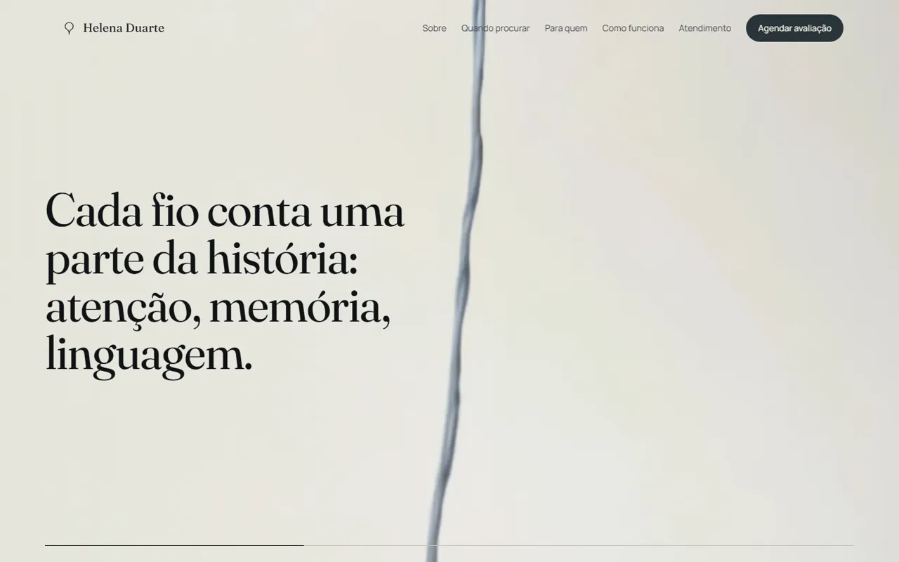
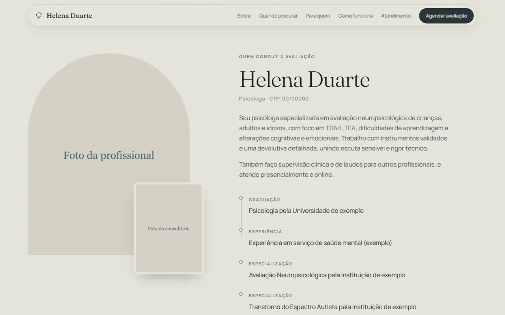

# Site cinematográfico para psicóloga, versão Mente e Coração

Site estático para psicóloga com foco em avaliação neuropsicológica. O topo é um vídeo de um cérebro de lã que se desfaz num fio, vira um coração e depois um monte de fios, controlado pela rolagem: cada gesto da roda do mouse leva até a próxima frase inteira, e no celular um botão passa as frases. Começou como projeto freelance para uma cliente real; este repositório é a versão base, com profissional, contatos, endereços e fotos fictícios.

**Demonstração ao vivo:** https://site-psicologa-mente-coracao-template.davi-santiago-6-68d.workers.dev



## Resumo

| | |
|---|---|
| Papel | Desenvolvimento completo: direção visual a partir do vídeo, front-end, testes, desempenho e publicação |
| Stack | TypeScript, Vite, GSAP (ScrollTrigger), Lenis, Canvas 2D, Vitest, Playwright, ffmpeg, Cloudflare Workers |
| Testes | 14 unitários (Vitest) e 18 de ponta a ponta (Playwright) contra o build de produção, em desktop, iPhone 13 no Chromium e iPhone no WebKit |
| Desempenho | LCP de 2,29 s num iPhone com rede lenta simulada e 612 ms no desktop, CLS 0 |
| Acessibilidade | `prefers-reduced-motion` com topo parado, contraste AA conferido, navegação por teclado e textos alternativos |

## O que o site faz

- **Topo em passos.** O vídeo vira 160 quadros (7,0 MB no desktop e 4,6 MB no celular, em WebP) desenhados num canvas. No desktop, o callback `virtualScroll` do Lenis intercepta a roda só enquanto a página está no topo e anima até a próxima parada (0; 0,32; 0,55; 0,795; 1 do progresso) com a rolagem travada. Se a página parar no meio por outro meio (barra de rolagem, teclado), ela completa até a frase mais próxima.
- **Celular com botão.** No celular o topo ocupa uma tela e não depende da rolagem: um botão "Próximo" com contador anima o progresso da sequência, e na última frase vira um atalho para o conteúdo.
- **Carregamento em ordem de pontas e passos.** Primeiro e último quadro, depois passos de 16, 8, 4, 2 e 1, com 6 downloads simultâneos. Enquanto um quadro não chega, aparece o vizinho carregado mais próximo.
- **Resto da página.** Seções escuras, galeria horizontal fixada na tela no desktop (rolagem nativa com scroll-snap no celular), etapas que se alternam sozinhas e pausam fora da tela, linha do tempo que cresce com a rolagem e dúvidas frequentes sem JavaScript. Tipografia Fraunces e Manrope, paleta tirada do próprio vídeo.


## Problemas que apareceram no caminho

- **Paradas em quadros ruins.** Na primeira versão, a quarta parada mostrava o coração cortado no alto da tela. Gerei folhas de contato dos quadros com ffmpeg e movi a parada para o quadro 127, em que só o fio solto atravessa a tela, e a frase passou para o lado vazio da imagem.
- **Botão escondido no Chrome do iPhone.** O topo tinha `100svh`, mas a barra de baixo do Chrome cobre parte dessa área. O botão ficava fora da tela, a pessoa rolava para achar e o texto passava por baixo do cabeçalho. Agora o topo usa a menor altura entre `innerHeight`, `visualViewport` e a altura do documento, recalculada só quando a tela gira.
- **Testes também no WebKit.** O Chrome do iPhone usa o motor do Safari, e diferenças de layout entre ele e o Chromium só apareciam no aparelho. O Playwright passou a rodar um projeto de iPhone no WebKit.
- **Toque roubado.** O botão flutuante do WhatsApp estava invisível no topo, mas continuava recebendo toques bem em cima do contador do "Próximo". Agora ele só aceita toque quando aparece, e um teste confere com `elementFromPoint` que nada cobre o botão.

## Desempenho

Medido com Playwright e PerformanceObserver sobre o build de produção (o Lighthouse não abriu na máquina de desenvolvimento):

| Cenário | FCP | LCP | CLS |
|---|---|---|---|
| iPhone 13, 1,6 Mbps, 150 ms, CPU 4x mais lenta | 936 ms | 2,29 s | 0 |
| Desktop 1440x900, 10 Mbps, 40 ms | 320 ms | 612 ms | 0 |

O pôster é o LCP, a primeira frase já vem no HTML e os quadros e imagens têm cache imutável de um ano. Detalhes em `docs/arquitetura.md`.



## Testes

A lógica pura (índice do quadro pelo progresso, recorte tipo `cover`, ordem de carga, vizinho mais próximo, opacidade das frases, cálculo das paradas) tem teste unitário. Os testes de ponta a ponta conferem comportamento:

- o canvas pinta e a rolagem não gera erro no console;
- cada gesto da roda para numa frase inteira, para cima e para baixo, e uma parada no meio completa até a frase mais próxima;
- no celular, o botão fica inteiro na tela, nada fica por cima dele e cada toque avança uma frase;
- com movimento reduzido, o topo aparece parado com pôster e frases;
- os links de contato têm destino válido e todas as imagens existem.

```bash
npm test
npx playwright install chromium webkit
npm run test:e2e
```

## Rodar e publicar

```bash
npm ci
npm run dev
npm run deploy   # Cloudflare Workers com assets estáticos; precisa de npx wrangler@4 login
```

Os quadros saem do vídeo com ffmpeg (`libwebp`). Os argumentos são o vídeo, o número de quadros, o foco horizontal do recorte do celular e a largura do desktop:

```bash
npm run quadros -- caminho/do/video.mp4 160 0.58 1920
```

Depois de trocar o vídeo, atualize `FRAMES` em `src/main.ts`, os intervalos `data-from`/`data-to` das frases em `index.html` e as paradas em `src/passos.ts`.

## Documentação

- `docs/arquitetura.md`: decisões técnicas, peso dos quadros, publicação e medições.
- `docs/design.md`: paleta tirada do vídeo, tipografia, frases do topo e ordem das seções.
- `docs/personalizar.md`: tudo o que é fictício e o que trocar para uma cliente nova.
